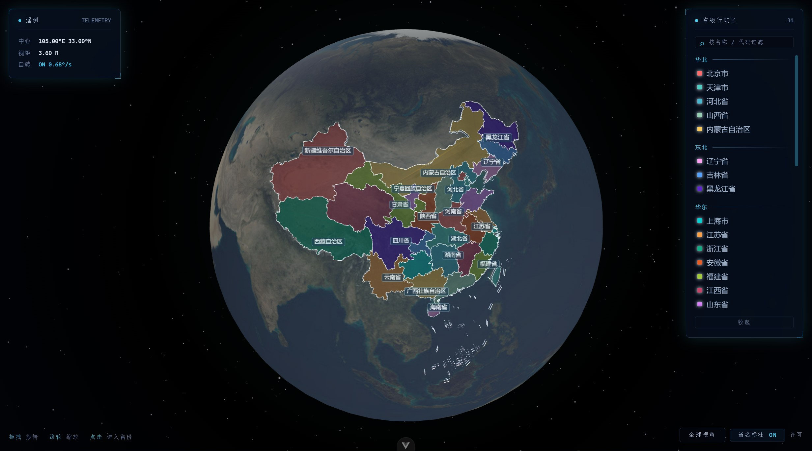
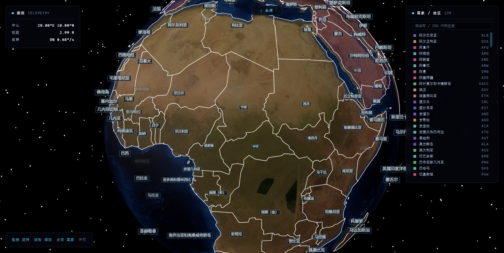
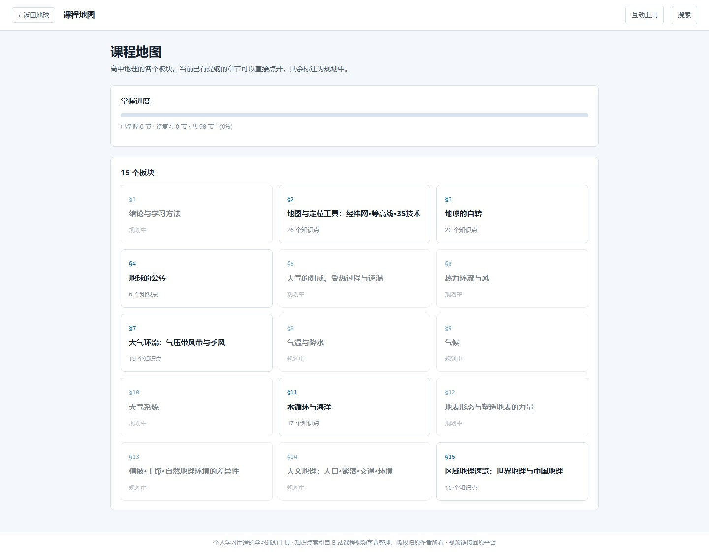
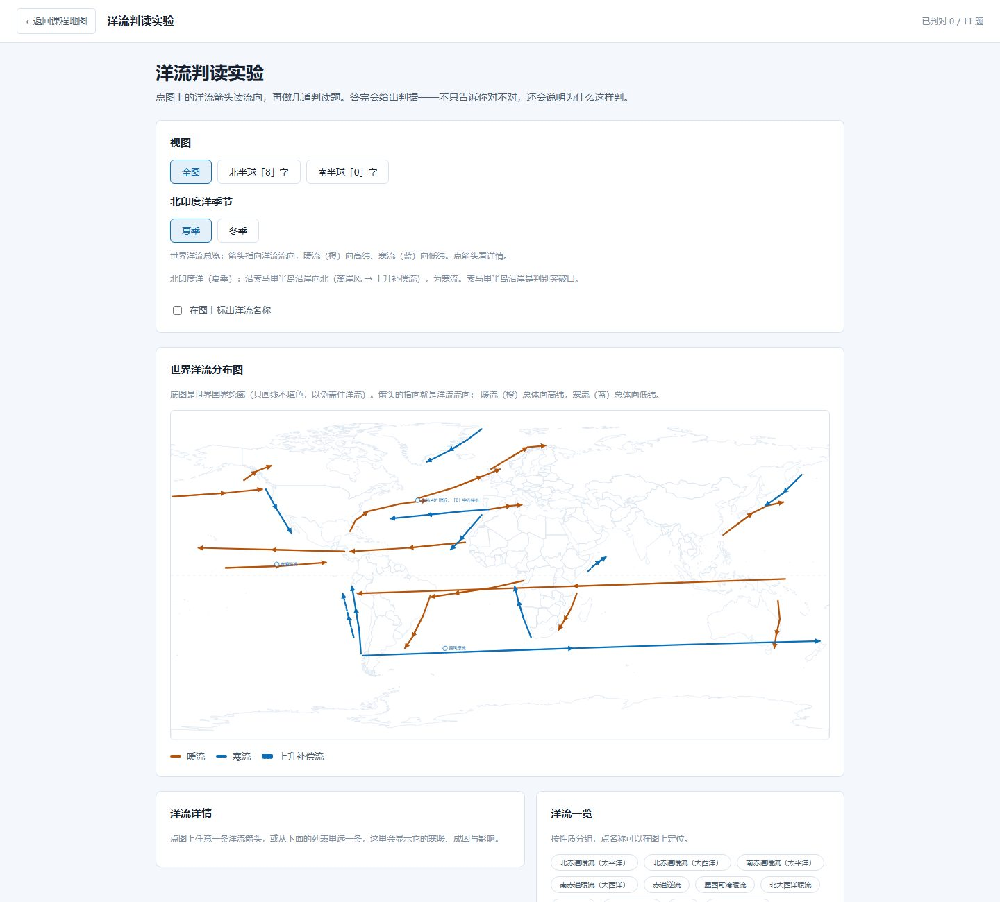
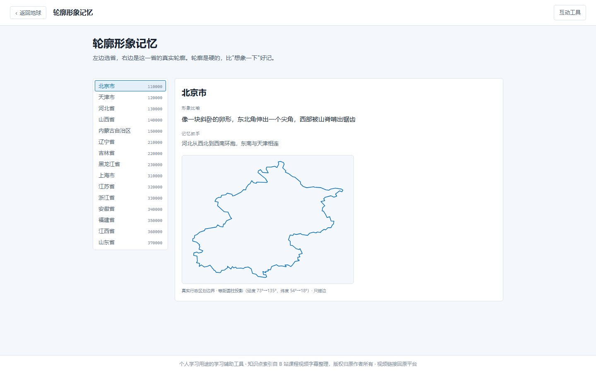
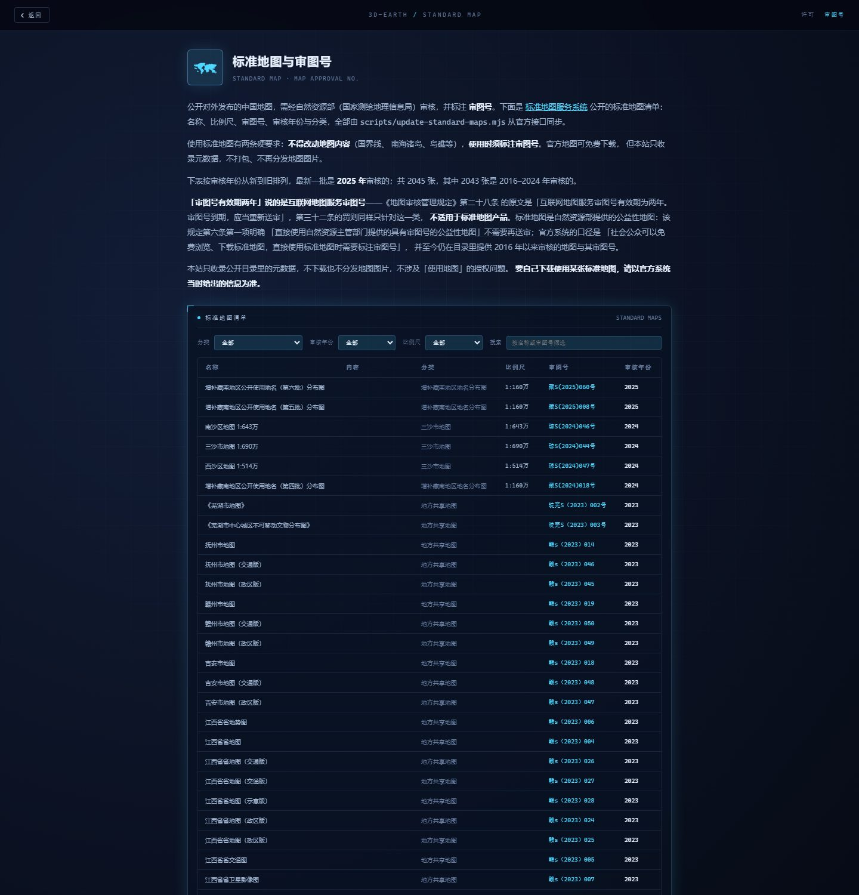

<div align="center">



# 3D-earth

**基于 Three.js 的 3D 地球可视化 · 高中地理学习工具**

中国 35 个省级行政区 · 全球 239 个国家/地区 · 标准地图审图号清单 · 课程地图与知识点提纲 · 六个动手练的互动工具

在线体验：<https://echovagant.github.io/3D-earth/>

[](https://github.com/Echovagant/3D-earth/actions/workflows/ci.yml)
[](https://github.com/Echovagant/3D-earth/actions/workflows/pages.yml)
[](https://github.com/Echovagant/3D-earth/stargazers)
[](https://github.com/Echovagant/3D-earth/network/members)
[](./LICENSE)

</div>

---

## 能做什么

| 能力 | 说明 |
|---|---|
| 🌐 球面渲染 | 35 个省级要素按真实边界贴合球面，白色描边 + 固定配色 |
| 🗺️ 多岛几何 | 三沙群岛、台湾离岛、舟山群岛、南海断续线全部正确渲染 |
| 🎯 HUD 拾取 | 准星锁定 + 引线标注 + 实时遥测（中心经纬 / 视距 / 自转） |
| 🧭 聚焦联动 | 点击省份 → 相机飞向该省并暂停自转 → 进入详情页 |
| 🌍 全球视角 | 239 个国家/地区按真实边界贴上球面，中文国名标注，点国家进详情页 |
| 🎨 分区图例 | 按地理分区分组配色，与球面悬停双向联动，可按名称或代码过滤 |
| 🏷 球面省名 | 省名钉在球面上，屏幕空间自动去重叠，放大后小省逐个浮现 |
| 📇 详情页 | 行政区划代码、中心坐标、球面实算面积、省情简介与标签 |
| 🗒 审图号清单 | 2000+ 张官方标准地图的审图号同步到站，可查、可溯源 |
| 📚 课程地图 | 15 个板块的知识点提纲，可查、可标记掌握情况，点回原视频 |
| 🔍 知识点搜索 | 标题、要点、易错点全字段检索；**按省名也能搜**（搜「四川」直接命中相关小节） |
| 🧮 动手练 | 6 个互动实验：等高线判读、太阳高度角与晨昏线、气压带风带、洋流、省会简称全表、轮廓形象记忆 |
| 🗺 省 ↔ 知识点 | 点省能点到该省适用的知识点：§15 按行政区组织，§2 按地形类型关联（平原、黄土高原、青藏高原、四川盆地各有各的读图法） |
| 🧪 有测试 | 500+ 个用例，CI 在每次 push 与 PR 上自动验证 |

## 界面

<p align="center">
  
</p>

<p align="center">
  
</p>

<p align="center">
  
</p>

<p align="center">
  
</p>

### 互动工具

<p align="center">
  
</p>

<p align="center">
  
</p>

<p align="center">
  
</p>

<p align="center">
  
</p>

## 技术亮点

**多岛几何的正确三角化.** 多岛屿省份在 GeoJSON 里是 `MultiPolygon`，而 earcut 的索引在每个 polygon 内部从 0 开始——顶点表跨 polygon 累加会让第 2 个及以后的 polygon 错位引用第 1 个的顶点，结果是海南 133 个岛礁只渲染出 1 个。顶点表按 polygon 重建后，35 个要素的几何全部归位。

**面积是算出来的，不是抄来的.** 行政区的「边界围合面积」直接用球面鞋带公式从边界算，洞（内环）从外环里扣掉。沿海省份的行政边界包含管辖海域，因此比常引用的陆地面积偏大——深圳约 +7%、珠海约 +12%。

**贴图的颜色空间必须是 sRGB.** JPEG 里存的是 sRGB 编码的数据，而 three.js 默认把贴图当线性数据处理——漏掉 `texture.colorSpace = THREE.SRGBColorSpace`，画面会整体发灰、对比度被压掉，卫星影像看起来像蒙了一层雾。这个问题曾让「贴图模糊」被误判成分辨率不足：实测把 4096×2048 换成 8192×4096（NASA 有 21600×10800 的更高精原图，高频能量是 5400 版的 2.67 倍），最终画面的锐度只提升了 **0.2%**。贴图因此直接用 NASA 原图，不做任何色彩补偿。`src/__tests__/textureColorSpace.spec.js` 扫源码守这一条——新加的贴图加载点忘了声明颜色空间就会红。

**首屏不等大图.** 地球贴图备了两份：512×256（19 KB）给首屏，4096×2048（741 KB）在后台换。小图在 `index.html` 里用 `<link rel="preload">` 预加载，浏览器在解析 JS 之前就开始下载。等大图才画球的话，首屏是一颗深色球体——看着像页面坏了，而不是像「还在加载」。主贴图本身也压过一轮（4:2:0 重新编码，PSNR 38.35 dB，肉眼无损），910 KB → 741 KB。

## 数据来源与许可

代码与第三方数据适用不同许可，**逐项来源、许可与义务见 [LICENSES.md](./LICENSES.md)**，站内也有同样一份：路由 `/licenses`。

| 数据 | 来源 | 许可 |
|---|---|---|
| 中国省界 + 南海断续线 | [DataV.GeoAtlas 行政区划边界](https://geo.datav.aliyun.com/areas_v3/bound/100000_full.json)（阿里云） | 上游公开接口数据，随仓库分发 |
| 世界国界（239 国/地区） | 几何与中文名：`@surbowl/world-geo-json-zh`；大洲与次区域：联合国 M49（`un-m49`） | **Unlicense**（公有领域）+ **MIT** |
| 地球贴图 | NASA Blue Marble Next Generation「地形与水深」2004 年 7 月版，4096×2048 母版 + 512×256 首屏小图 | NASA 影像一般不受著作权保护，无需许可 |
| 省份人口与简介 | 2023 年末公开统计口径，逐条标注来源 | 各来源归各自权利人 |
| 课程知识点提纲 | 自课程视频字幕整理的提纲（名称、要点清单、易错点、依赖关系） | 版权归原作者所有，本站仅索引与跳转 |
| 第三方库 | Vue / Vue Router / Three.js（MIT）、earcut（ISC） | 见 `package.json` |

本项目是**纯静态前端**：没有后端、没有统计脚本、不使用 Cookie、不收集也不上传任何个人信息。

### 地图合规

标准地图元数据来自自然资源部标准地图服务系统公开的清单（名称、比例尺、审图号、审核年份、分类），从官方接口抓取整理，覆盖 2000 余张。

| 地图 | 审图号 | 审核年份 |
|---|---|---|
| 增补藏南地区公开使用地名（第六批）分布图 1:160万 | 藏S(2025)060号 | 2025 |
| 三沙市地图 1:690万 | 琼S(2024)044号 | 2024 |
| 中国地图 1:1000万 对开（界线版 有邻国 线划二） | GS(2023)2762号 | 2023 |
| 亚洲地图 1:2500万 4开 | GS(2023)2761号 | 2023 |
| 世界地图 1:4100万 对开（分国设色 线划一） | GS(2021)5443号 | 2021 |

清单按审核年份从新到旧排列，可按分类、年份、比例尺筛选或按名称搜索。2002 张里最新一批是 2025 年审核的，其余 2000 张是 2016–2024 年审核的。

**「审图号有效期两年」说的是互联网地图服务审图号，不是标准地图产品。**《地图审核管理规定》第二十八条的原文是「互联网地图服务审图号有效期为两年。审图号到期，应当重新送审」，第三十二条的罚则同样只针对这一类。标准地图是自然资源部提供的**公益性地图**——该规定第六条第一项明确「直接使用自然资源主管部门提供的具有审图号的公益性地图」不需要再送审；官方系统的口径是「社会公众可以免费浏览、下载标准地图，直接使用标准地图时需要标注审图号」，并至今仍在目录里提供 2016 年以来审核的地图与审图号。

本站只收录公开目录里的元数据，不下载也不分发地图图片，不涉及「使用地图」的授权问题。**要自己下载使用某张标准地图，请以官方系统当时给出的信息为准。**

审图号是对**特定平面地图产品**的核准编号，绑定那张地图的内容与表现形式。本站把行政区划投到球面上、重新配色、加了标注与交互，是另一种表现形式，因此**不能沿用标准地图的审图号**，也不应被当作「经审核的标准地图」转发。需要审图号齐全的地图，请到[标准地图服务系统](http://bzdt.ch.mnr.gov.cn/)下载。

<p align="center">
  
</p>

### 收录口径

行政区划以官方发布为准，本项目不替代官方数据：

- **省级**：34 个省级行政区 + 1 个南海断续线要素，与[国家统计局行政区划](https://data.stats.gov.cn/)口径一致
- **面积**：由边界几何在球面上实算；**人口**：2023 年末常住人口，34 个省级单位合计与全国人口相差约 2%
- **世界视角**：按 ISO 3166-1 收录 239 个国家/地区；**中国地图里的台湾省作为中国的一个省级行政区呈现**，不作为独立条目
- **科索沃**：上游数据集没有为它单列国别，那块地并入塞尔维亚的轮廓——地图上看不出缺口，但国家列表里没有它
- **课程内容**：知识点提纲目前只覆盖第 2 章（地图与定位工具）与第 15 章（区域地理），其余 13 章在课程地图里标为「规划中」；但「互动工具」已经覆盖到 §3、§4、§7、§11 的机制部分
- **内容来源**：提纲与练习整理自一套公开的高中地理教学视频，每个工具页与知识点页都标了对应节号、教材出处与原视频分P；站内只放自撰的提纲与题干，不收录讲义正文

## 快速开始

需要 Node.js ≥ 20.19 或 ≥ 22.12。

```sh
npm install
npm run dev        # 开发服务器
npm run check      # lint + 测试 + 构建，与 CI 跑的是同一套
```

## 贡献

欢迎提 issue 与 PR。开始之前请读 [AGENTS.md](./AGENTS.md)，里面是完整的目录职责、命令、硬约束与代码约定。

几条最容易踩的：

- **不要手工修改 `public/geojson/` 下的文件**，它们是只读数据源，由脚本从上游同步
- **新增或更换数据源前先查许可**：优先选有明确开放许可的（Unlicense / MIT / ODbL / 公有领域）；付费数据集、仅供学习研究使用的采集站、来源不明的镜像都不要用。改完记得在 `LICENSES.md` 里登记来源、许可与义务

## License

代码：[Apache License 2.0](./LICENSE)　·　数据与素材：见 [LICENSES.md](./LICENSES.md)
