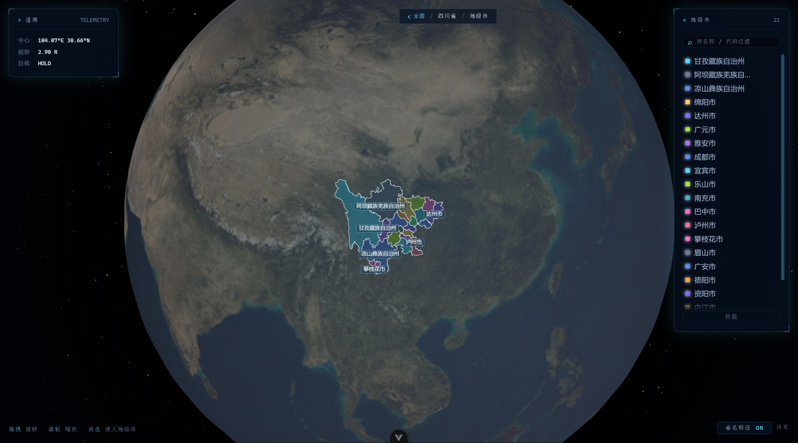

<div align="center">


# 3D-earth

**基于 Three.js 的 3D 地球可视化**

中国 35 个省级行政区实时渲染 · 球面拾取与相机聚焦 · 可下钻到地级市

[](https://github.com/Echovagant/3D-earth/actions/workflows/ci.yml)
[](https://github.com/Echovagant/3D-earth/stargazers)
[](https://github.com/Echovagant/3D-earth/network/members)
[](./LICENSE)

</div>

---

## 这是什么

把省级行政区的真实边界三角化后贴合到球面，渲染成一个可以拖拽旋转、悬停拾取、点击聚焦的 3D 地球。界面是深空科技 HUD 风格：左上角实时遥测读数，右上角按地理分区排列的图例，鼠标悬停时出现准星锁定与引线标注。

进到省份详情页后还能继续下钻：该省的地级市按真实边界铺到球面上，点任意一个市进入它的详情页。

<p align="center">
  
</p>

<p align="center">
  
</p>

## 核心能力

| | |
|---|---|
| 🌐 球面渲染 | 35 个省级要素按 GeoJSON 边界贴合球面，白色描边 + 固定 adcode 配色 |
| 🎯 HUD 拾取 | 准星锁定 + 引线标注 + 遥测面板（中心经纬 / 视距 / 自转状态） |
| 🗺️ 完整多岛几何 | 三沙群岛、台湾离岛、舟山群岛、南海断续线全部正确渲染 |
| 🧭 聚焦联动 | 点击省份 → 相机飞向该省并暂停自转 → 进入详情页 |
| 🏙 地级市下钻 | 省份详情页一键下钻，该省地级市按真实边界铺上球面，再点城市进详情页 |
| 📇 详情页 | 行政区划代码、中心坐标、面积人口、省情简介与标签 |
| 🎨 分区图例 | 按华北 / 东北 / 华东 / 华中 / 华南 / 西南 / 西北 / 港澳台分组，与球面悬停双向联动 |
| 🏷 球面省名标注 | 省名钉在球面上，屏幕空间自动去重叠；放大后小省逐个浮现，可一键开关 |
| 🔍 图例过滤 | 按省名或行政区划代码即时过滤 |
| ♿ 动效降级 | 遵循系统的「减少动态效果」设置 |
| 🧪 有测试 | 122 个用例，CI 在每次 push 与 PR 上自动验证 |

## 实现要点

**多岛几何的正确三角化.** 多岛屿省份（海南、台湾、浙江、广东、辽宁…）在 GeoJSON 里是 `MultiPolygon`。earcut 的索引在每个 polygon 内部从 0 开始，如果顶点表跨 polygon 累加，第 2 个及以后的 polygon 会错位引用第 1 个 polygon 的顶点——结果是海南 133 个岛礁只渲染出 1 个，南海断续线 10 段只剩 2 段。顶点表按 polygon 重建后，35 个要素的几何全部归位。

**几何正确性用像素比对验证，不靠肉眼.** 把「原始 GeoJSON 期望覆盖」与「实际渲染三角形」分别栅格化成像素图后逐像素比对，能得到可量化的缺失率与错位率。修复前南海区域缺失 1.2%、错位 1.9%；修复后缺失 0%。测试里另有一份独立写的参考实现做逐顶点比对，专治「顶点数对得上但坐标错位」这类包围盒测不出的 bug。

**Three.js 的资源生命周期.** 组件卸载时遍历场景释放几何体、材质与贴图并解绑事件监听；只调用 `renderer.dispose()` 只能回收 WebGL 上下文，几何体与材质仍会留在 GPU 上。

**拾取只针对需要的对象.** 射线只对省份组求交，避免每次 `mousemove` 都遍历整个场景（含 5000 个点的星空）。指针位置走非响应式通道 + 命令式 DOM 写入，不触发组件重渲染。

**地级市边界按需拉取，不进仓库.** 34 个省的地级市边界全量约 6.5 MB，且绝大多数用户只看一两个省。改成进到下钻页时才向 DataV 请求那一个省的文件（单省约 190 KB），省级边界仍随仓库分发。

**面积是算出来的，不是抄来的.** 地级市的行政面积直接用球面鞋带公式从行政区划边界算，洞（内环）从外环里扣掉。这是「边界围合面积」：内陆城市与官方口径差 1% 左右，沿海城市的行政边界包含管辖海域，因此比常引用的陆地面积偏大——深圳约 +7%、珠海约 +12%。

## 数据来源

| 文件 | 内容 | 来源 |
|---|---|---|
| `public/geojson/china-provinces.json` | 34 个省级行政区 + 1 个南海断续线要素（`adcode = 100000_JD`） | [DataV.GeoAtlas 行政区划边界](https://geo.datav.aliyun.com/areas_v3/bound/100000_full.json) |
| `public/geojson/china.json` | 中华人民共和国整体边界 | [DataV.GeoAtlas 行政区划边界](https://geo.datav.aliyun.com/areas_v3/bound/100000.json) |
| `public/textures/earth_atmos_2048.jpg` | 地球贴图 | 随仓库提供 |
| `public/data/provinces/<adcode>.json` | 省份详情页数据 | 随仓库提供 |
| 地级市边界 | 下钻时按省从 `geo.datav.aliyun.com` 实时拉取 | [DataV.GeoAtlas 行政区划边界](https://geo.datav.aliyun.com/areas_v3/bound/) |

仓库内是随代码分发的副本，与上游同步。`public/geojson/` 下的两个文件保持上游原样——其中 `adcode` 是数字（南海断续线要素例外，是字符串 `100000_JD`），`public/data/provinces/` 里的 `adcode` 是字符串，与文件名一致；代码里统一用 `String()` 比较，两种类型都能对上。

`public/geojson/` 下的两个文件是**只读数据源，不要手工修改**——它们由 `scripts/update-geo.mjs` 从上游同步，手工改动会在下次同步时被覆盖。地级市边界不进仓库——需要联网，且只在用户下钻时才请求。

## 地理数据同步

行政区划边界来自 [DataV.GeoAtlas](https://geo.datav.aliyun.com/areas_v3/bound/)，由一条 GitHub Actions 定时任务每周同步一次：

```sh
npm run geo:check      # 校验本地数据与上游是否一致（只读）
npm run geo:update     # 同步到 public/geojson/
```

同步脚本在写盘之前会校验上游数据：要素数、几何类型、坐标格式都要合法。**行政区划的新增或撤销会被直接拒绝**——那会牵动配色、图例与详情页数据，需要人工确认后再改。流水线只在边界真的变了时才产生提交，提交信息里会列出哪些要素的边界变了。

## 快速开始

需要 Node.js ≥ 20.19 或 ≥ 22.12。

```sh
npm install
npm run dev            # 开发服务器
npm run test:unit      # 跑一次测试
npm run lint:check     # ESLint 检查（不改动文件）
npm run build          # 生产构建
npm run check          # 上面三项串起来，与 CI 跑的是同一套
npm run geo:check      # 校验本地地理数据与上游是否一致
```

## 项目状态

**已完成**

- 球面渲染与完整多岛几何（35 个要素）
- 悬停拾取、图例双向联动、图例过滤
- 球面省名标注（屏幕空间去重叠）
- 点击聚焦与相机飞行
- 省份详情页
- 地级市层级下钻（省 → 市两级球面视图 + 市详情页）
- 地理数据自动更新流水线（定时同步上游边界，变更前校验）
- 深空科技 HUD 界面
- 122 个单元测试 + CI 流水线

**进行中**

- 详情页数据目前是示例值，正在接入权威省情数据

## 目录结构

```
src/
  App.vue                    应用外壳
  main.js                    入口：装配 router，装全局错误兜底
  styles/tokens.css          设计令牌（颜色 / 字号 / 间距 / 动效）
  router/index.js            路由表
  components/
    EarthScene.vue           地球场景：Three.js 初始化、渲染循环、拾取与交互
    HudPanel.vue             通用玻璃面板（四角角标）
    ProvinceLegend.vue       分区图例
    ProvincePage.vue         省份详情页
    DrillView.vue            地级市视角（把 EarthScene 切到省级以下范围）
    CityPage.vue             地级市详情页
  utils/
    geoDataProcessor.js      GeoJSON → 球面 Mesh 的三角化、贴面与描边
    provinceColors.js        adcode → 颜色的稳定映射与地理分区
    provinceLabels.js        球面标注的贴面定位、屏幕空间去重叠
    areaData.js              行政区划数据获取、球面面积计算
  __tests__/                 Vitest 用例
scripts/
  update-geo.mjs             地理数据同步：拉取、校验、写入
public/
  geojson/                   地理数据源（只读，由脚本更新）
  data/provinces/            省份详情页静态数据
  textures/                  地球贴图
docs/                        README 引用的界面截图
```

## 当前限制

- 地球贴图为 2048×1024 近地表图，放大到省级尺度会有明显模糊
- 详情页数据为静态示例值，没有后端与实时数据源
- 地级市下钻依赖 DataV 的在线接口：断网或该服务不可用时下钻会失败（界面会给出错误提示与重试按钮）
- 依赖漏洞审计（`npm audit`）需切到官方 npm registry 执行，国内镜像不实现该接口
- 主包约 630 kB（几乎全部是 three.js）：详情页与下钻页已按路由做了代码分割，three 仍是首屏刚需，拆包只改变缓存策略、不减少首屏字节数
- 球面交互目前只支持鼠标

## 贡献

欢迎提 issue 与 PR。开始之前请读 [AGENTS.md](./AGENTS.md)，里面是完整的目录职责、命令、硬约束与代码约定。

几条最容易踩的：

- **不要修改 `public/geojson/` 下的两个文件**，它们是只读数据源
- 改动涉及几何处理时，务必跑 `npm run test:unit`——`src/__tests__/geoDataProcessor.spec.js` 会校验 35 个要素的渲染范围与参考实现逐顶点一致
- 提交信息用 `git commit -F <文件>`，不要用 `git commit -m "..."`：PowerShell 下双引号会吞掉反引号并可能破坏中文
- 三角化时顶点表必须按 polygon 重建，这是本项目最容易被重新引入的 bug

## License

[Apache License 2.0](./LICENSE)
