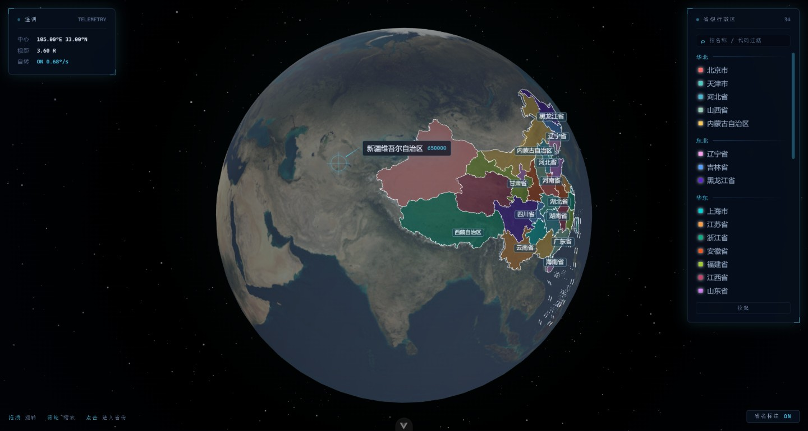

<div align="center">



# 3D-earth

**基于 Three.js 的 3D 地球可视化**

中国 35 个省级行政区实时渲染 · 球面拾取与相机聚焦 · 省份详情页

[](https://github.com/Echovagant/3D-earth/stargazers)
[](https://github.com/Echovagant/3D-earth/network/members)
[](./LICENSE)

</div>

---

## 这是什么

把 GeoJSON 里的省级行政区边界三角化后贴合到球面，渲染成一个可以拖拽旋转、悬停拾取、点击聚焦的 3D 地球。界面是深空科技 HUD 风格：左上角是实时遥测读数，右上角是分区图例，鼠标悬停时出现准星锁定与引线标注。

<p align="center">
  
</p>

## 技术看点

**多岛几何的正确三角化.** 多岛屿省份（海南、台湾、浙江、广东、辽宁…）在 GeoJSON 里是 `MultiPolygon`。earcut 的索引在每个 polygon 内部从 0 开始，如果顶点表跨 polygon 累加，第 2 个及以后的 polygon 会错位引用第 1 个 polygon 的顶点——结果是海南 133 个岛礁只渲染出 1 个，九段线 10 段只剩 2 段。顶点表按 polygon 重建后，35 个要素的几何全部归位。

**几何正确性用像素比对验证，不靠肉眼.** 把「原始 GeoJSON 期望覆盖」与「实际渲染三角形」分别栅格化成像素图后逐像素比对，能得到可量化的缺失率与错位率。修复前南海区域缺失 1.2%、错位 1.9%；修复后缺失 0%。`src/__tests__/geoDataProcessor.spec.js` 里另有一份独立写的参考实现做逐顶点比对，专治「顶点数对得上但坐标错位」这类包围盒测不出的 bug。

**Three.js 的资源生命周期.** 组件卸载时遍历场景释放几何体、材质与贴图并解绑事件监听；只调用 `renderer.dispose()` 只能回收 WebGL 上下文，几何体与材质仍会留在 GPU 上。

**取样只针对需要的对象.** 拾取用射线只对省份组求交，避免每次 `mousemove` 都遍历整个场景（含 5000 个点的星空）。

## 功能

| | |
|---|---|
| 🌐 球面渲染 | 35 个省级要素按 GeoJSON 边界贴合球面，白色描边 + 固定 adcode 配色 |
| 🎯 HUD 拾取 | 准星锁定 + 引线标注 + 遥测面板（中心经纬 / 视距 / 自转状态） |
| 🗺️ 完整多岛几何 | 三沙群岛、台湾离岛、舟山群岛、南海断续线全部正确渲染 |
| 🧭 聚焦联动 | 点击省份 → 相机飞向该省并暂停自转 → 进入详情页 |
| 📇 详情页 | 行政区划代码、中心坐标、面积人口、省情简介与标签 |
| 🎨 分区图例 | 按华北 / 东北 / 华东 / 华中 / 华南 / 西南 / 西北 / 港澳台分组，与球面悬停双向联动 |
| 🧪 有测试 | 35 个要素的渲染范围覆盖 + 与参考实现逐顶点一致 |

## 技术栈

[](https://vuejs.org)
[](https://vite.dev)
[](https://threejs.org)
[](https://vitest.dev)
[](https://github.com/mapbox/earcut)

原生 Three.js（未使用 TresJS）。状态层用 Pinia，几何处理为纯函数模块。

## 快速开始

需要 Node.js ≥ 20.19 或 ≥ 22.12。

```sh
npm install
npm run dev            # 开发服务器
npm run test:unit      # 跑一次测试
npm run lint           # ESLint
npm run build          # 生产构建
```

## 目录结构

```
src/
  App.vue                    应用外壳
  main.js                    入口：装配 router 与 pinia
  styles/tokens.css          设计令牌（颜色 / 字号 / 间距 / 动效）
  router/index.js            路由表
  components/
    EarthScene.vue           地球场景：Three.js 初始化、渲染循环、拾取与交互
    HudPanel.vue             通用玻璃面板（四角角标）
    ProvinceLegend.vue       分区图例
    ProvincePage.vue         省份详情页
  utils/
    geoDataProcessor.js      GeoJSON → 球面 Mesh 的三角化、贴面与描边
    provinceColors.js        adcode → 颜色的稳定映射与地理分区
  __tests__/                 Vitest 用例
public/
  geojson/china-provinces.json   35 个省级要素
  geojson/china.json              国家级边界
  data/provinces/<adcode>.json   省份详情页静态数据
  textures/earth_atmos_2048.jpg  地球贴图
```

## 地理数据

省级边界为随仓库提供的 GeoJSON（EPSG:4326 经纬度坐标）。

`public/geojson/china-provinces.json` 共 35 个要素：

| 要素 | 说明 |
|---|---|
| 34 个省级行政区 | `properties.level = "province"`，含 `adcode`（6 位行政区划代码）、`name`、`center`、`centroid` |
| 1 个断续线要素 | `adcode = "100000_JD"`，即南海断续线 |

`public/geojson/china.json` 为国家级边界（`level = "country"`），用于绘制中国区域底板与国界。

> 这两个 GeoJSON 文件是**只读数据源，请勿修改**。三角化在经纬度平面上完成（earcut），再把顶点映射到半径 2 的球面；多岛屿省份的每个 polygon 必须独立三角化。

详情页数据在 `public/data/provinces/<adcode>.json`，其中 `adcode` / `name` / `center` 与 GeoJSON 严格一致，其余字段为公开地理常识的近似值。

## 已知限制

- 地球贴图为 2048×1024 近地表图，放大到省级尺度会有明显模糊
- 详情页数据为静态示例值，没有后端与实时数据源
- 依赖漏洞审计（`npm audit`）需切到官方 npm registry 执行，国内镜像不实现该接口
- 主包约 600 kB（几乎全部是 three.js），未做代码分割——three 是首屏刚需，拆包只改变缓存策略、不减少首屏字节数

## 贡献

欢迎提 issue 与 PR。改动涉及几何处理时，请务必跑 `npm run test:unit`：`src/__tests__/geoDataProcessor.spec.js` 会校验 35 个要素的渲染范围与参考实现逐顶点一致。更多约定见 [AGENTS.md](./AGENTS.md)。

## License

[Apache License 2.0](./LICENSE)

与 MIT 同为宽松协议，额外包含明确的专利授权与专利报复条款。
