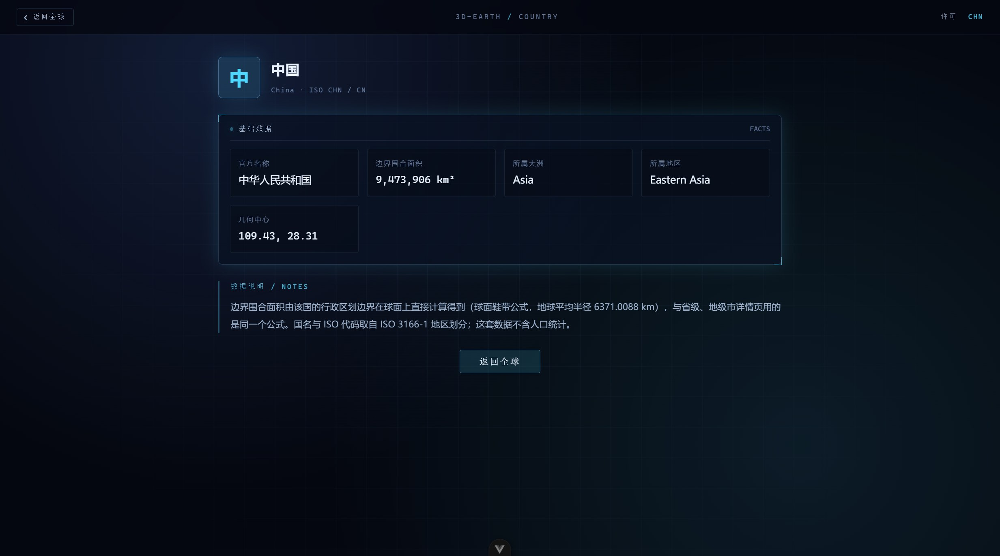

<div align="center">


# 3D-earth

**基于 Three.js 的 3D 地球可视化**

中国 35 个省级行政区实时渲染 · 可下钻到地级市 · 全球 239 个国家/地区视角

[](https://github.com/Echovagant/3D-earth/actions/workflows/ci.yml)
[](https://github.com/Echovagant/3D-earth/stargazers)
[](https://github.com/Echovagant/3D-earth/network/members)
[](./LICENSE)

</div>

---

## 这是什么

把真实行政区划边界三角化后贴合到球面，渲染成一个可以拖拽旋转、悬停拾取、点击聚焦的 3D 地球。界面是深空科技 HUD 风格：左上角实时遥测读数，右上角按地理分区排列的图例，鼠标悬停时出现准星锁定与引线标注。

中国视角下到省级、省份详情页再下钻到地级市；全球视角下到国家。

<p align="center">
  
</p>

<p align="center">
  
</p>

<p align="center">
  
</p>

<p align="center">
  
</p>

## 核心能力

| | |
|---|---|
| 🌐 球面渲染 | 35 个省级要素按 GeoJSON 边界贴合球面，白色描边 + 固定 adcode 配色 |
| 🎯 HUD 拾取 | 准星锁定 + 引线标注 + 遥测面板（中心经纬 / 视距 / 自转状态） |
| 🗺️ 完整多岛几何 | 三沙群岛、台湾离岛、舟山群岛、南海断续线全部正确渲染 |
| 🧭 聚焦联动 | 点击省份 → 相机飞向该省并暂停自转 → 进入详情页 |
| 🏙 地级市下钻 | 省份详情页一键下钻，该省地级市按真实边界铺上球面，再点城市进详情页；台湾省 22 个县市同样可下钻 |
| 🌍 全球视角 | 239 个国家/地区按真实边界贴上球面，共用同一张卫星贴图、中文国名标注、点国家进详情页 |
| 📇 详情页 | 行政区划代码、中心坐标、实算面积、省情简介与标签 |
| 🎨 分区图例 | 按华北 / 东北 / 华东 / 华中 / 华南 / 西南 / 西北 / 港澳台分组，与球面悬停双向联动 |
| 🏷 球面省名标注 | 省名钉在球面上，屏幕空间自动去重叠；放大后小省逐个浮现，可一键开关 |
| 🔍 图例过滤 | 按省名或行政区划代码即时过滤 |
| ♿ 动效降级 | 遵循系统的「减少动态效果」设置 |
| 🧪 有测试 | 433 个用例，CI 在每次 push 与 PR 上自动验证 |

## 技术亮点

**多岛几何的正确三角化.** 多岛屿省份在 GeoJSON 里是 `MultiPolygon`，而 earcut 的索引在每个 polygon 内部从 0 开始——顶点表跨 polygon 累加会让第 2 个及以后的 polygon 错位引用第 1 个的顶点，结果是海南 133 个岛礁只渲染出 1 个。顶点表按 polygon 重建后，35 个要素的几何全部归位。

**几何正确性用像素比对验证，不靠肉眼.** 原始 GeoJSON 的期望覆盖与实际渲染三角形分别栅格化成像素图后逐像素比对，能得到可量化的缺失率与错位率。测试里另有一份独立写的参考实现做逐顶点比对，专治「顶点数对得上但坐标错位」这类包围盒测不出的 bug。

**面积是算出来的，不是抄来的.** 地级市的行政面积直接用球面鞋带公式从行政区划边界算，洞（内环）从外环里扣掉。沿海城市的行政边界包含管辖海域，因此比常引用的陆地面积偏大——深圳约 +7%、珠海约 +12%。

**地级市边界随仓库分发，下钻不依赖在线接口.** 34 个省的地级市边界全量约 3.9 MB、497 个要素，下钻时只下载用户点进去的那一个省。既不拖慢首屏，也不受第三方接口可用性影响。

**两个视角共用同一张卫星贴图与同一套材质.** 全球视角把国家面压到 45% 不透明度让底图透出来，并按联合国次区域上色，与中国视角的「按地理分区」是同一套设计语言。

**Three.js 的资源生命周期.** 组件卸载时遍历场景释放几何体、材质与贴图并解绑事件监听；只调用 `renderer.dispose()` 只能回收 WebGL 上下文，几何体与材质仍会留在 GPU 上。

**拾取只针对需要的对象.** 射线只对省份组求交，避免每次 `mousemove` 都遍历整个场景。指针位置走非响应式通道 + 命令式 DOM 写入，不触发组件重渲染。

## 数据来源与许可

仓库里同时有代码与第三方地理数据，两者适用不同许可。**逐项来源、许可与义务见 [LICENSES.md](./LICENSES.md)，应用内也有同样一份：路由 [`/licenses`](http://localhost:5173/licenses)。**

| 数据 | 来源 | 许可 |
|---|---|---|
| 中国省界、地级市界 | [DataV.GeoAtlas 行政区划边界](https://geo.datav.aliyun.com/areas_v3/bound/)（阿里云） | 上游公开接口数据 |
| 台湾省 22 个县市边界 | 几何：[geoBoundaries TWN ADM1](https://www.geoboundaries.org/)；属性：[内政部「縣市行政區劃」](https://www.moi.gov.tw/) | 几何 ODbL 1.0（衍生文件同样以 ODbL 1.0 提供） |
| 世界国界（239 国/地区） | 几何与中文名：`@surbowl/world-geo-json-zh`；大洲与次区域：联合国 M49 | Unlicense（公有领域）+ MIT |
| 地球贴图 | NASA Blue Marble Next Generation | NASA 影像一般不受著作权保护，无需许可 |
| 省份人口与简介 | 2023 年末公开统计口径，逐条标注来源 | 各来源归各自权利人 |

本项目是**纯静态前端**：没有后端、没有统计脚本、不使用 Cookie、不收集也不上传任何个人信息。

`public/geojson/` 下的文件是**只读数据源**，由 `scripts/` 下的同步脚本从上游取回后随仓库分发，不要手工修改。

## 快速开始

需要 Node.js ≥ 20.19 或 ≥ 22.12。

```sh
npm install
npm run dev            # 开发服务器
npm run test:unit      # 跑一次测试
npm run lint:check     # ESLint 检查（不改动文件）
npm run build          # 生产构建
npm run check          # 上面三项串起来，与 CI 跑的是同一套
npm run geo:check      # 校验本地地理数据与上游是否一致
```

## 目录结构

```
src/
  App.vue                    应用外壳
  main.js                    入口：装配 router，装全局错误兜底
  styles/tokens.css          设计令牌（颜色 / 字号 / 间距 / 动效）
  router/index.js            路由表
  components/
    EarthScene.vue           地球场景：Three.js 初始化、渲染循环、拾取与交互
    HudPanel.vue             通用玻璃面板（四角角标）
    ProvinceLegend.vue       分区图例
    ProvincePage.vue         省份详情页
    DrillView.vue            地级市视角（把 EarthScene 切到省级以下范围）
    CityPage.vue             地级市详情页
    WorldScene.vue           全球视角：世界国界、中文国名标注、国家拾取
    CountryPage.vue          国家详情页
    LicensesPage.vue         数据来源与许可
  utils/
    geoDataProcessor.js      GeoJSON → 球面 Mesh 的三角化、贴面与描边
    globeMath.js             球面交互纯函数：拾取归一化、飞行插值、球面质心
    provinceColors.js        adcode → 颜色的稳定映射与地理分区
    provinceLabels.js        球面标注的贴面定位、屏幕空间去重叠
    areaData.js              行政区划数据获取、球面面积计算
    worldData.js             世界国界数据获取、分区配色
  __tests__/                 Vitest 用例
scripts/
  update-geo.mjs             中国地理数据同步：省界、地级市边界、面积
  update-world.mjs           世界国界同步：拉取、校验、写入
  update-tw.mjs              台湾省县市边界同步
public/
  geojson/                   地理数据源（只读，由脚本更新）
  data/provinces/            省份详情页静态数据
  textures/                  地球贴图
docs/                        README 引用的界面截图
```

## 当前限制

- 地球贴图为 2048×1024 近地表图，放大到省级尺度会有明显模糊
- 省级详情页的人口是 2023 年末的公开统计口径，各省统计年份不完全一致
- 全球视角不含人口统计：国内没有可自动同步的权威人口源，改用边界实算面积
- 球面交互目前只支持鼠标
- 主包约 491 kB（几乎全部是 three.js）：three 已拆成独立块，业务代码迭代时用户不必重新下载它

## 贡献

欢迎提 issue 与 PR。开始之前请读 [AGENTS.md](./AGENTS.md)，里面是完整的目录职责、命令、硬约束与代码约定。

几条最容易踩的：

- **不要手工修改 `public/geojson/` 下的文件**，它们是只读数据源，由脚本从上游同步
- **新增数据源前先查许可**：优先选有明确开放许可的（Unlicense / MIT / ODbL / 公有领域）；付费数据集、仅供学习研究的采集站、来源不明的镜像都不要用。改完记得在 `LICENSES.md` 里登记
- 改动涉及几何处理时，务必跑 `npm run test:unit`——`src/__tests__/geoDataProcessor.spec.js` 会校验 35 个要素的渲染范围与参考实现逐顶点一致
- 提交信息用 `git commit -F <文件>`，不要用 `git commit -m "..."`：PowerShell 下双引号会吞掉反引号并可能破坏中文
- 三角化时顶点表必须按 polygon 重建，这是本项目最容易被重新引入的 bug
- 球面标注的 sprite 位置是**地球局部坐标**，与相机（世界坐标）比较前必须用 `earthLocalToWorld()` 转换，漏了会让标注全部消失

## License

代码：[Apache License 2.0](./LICENSE)　·　数据与素材：见 [LICENSES.md](./LICENSES.md)
